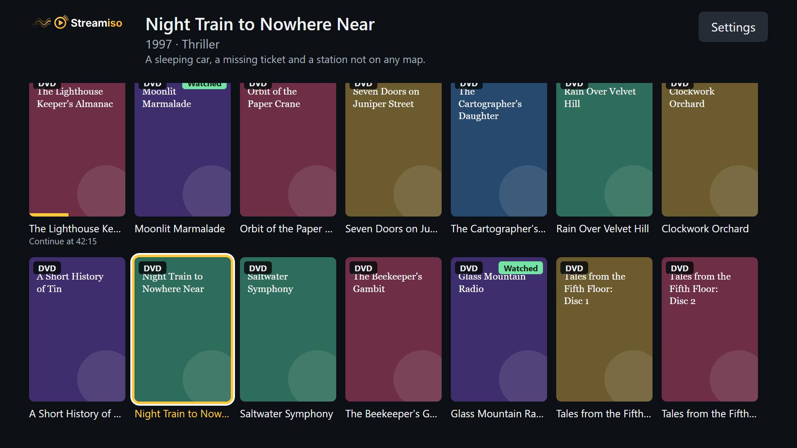
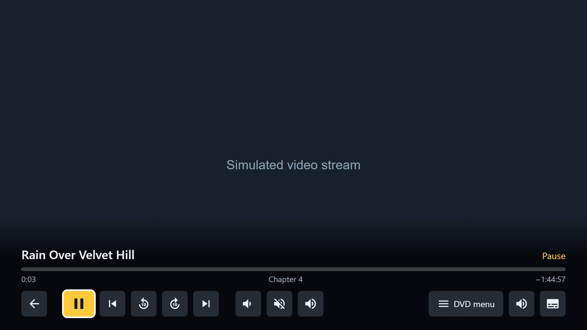

<p align="center">
  
</p>

# StreamISO for Samsung TV

A Samsung TV (Tizen) app for [StreamISO](https://github.com/rubinhos/streamiso), the self-hosted library that plays your
DVD images and audio CD images with their real menus. It has its own screens and controls, made for the remote. You need a
running StreamISO server. To learn more about StreamISO itself, see [its repository](https://github.com/rubinhos/streamiso).

> **Vibe coded:** written with an AI assistant ([Claude](https://claude.ai)) and tested by the author.
> **Early prototype:** tested on one TV, a 2020 model with Tizen 5.5.

| | |
|---|---|
|  |  |

## Which TVs

Samsung TVs from 2020 on (Tizen 5.5 or newer). The code is kept to what Chromium M69, the 2020 engine, understands, and
the video route is chosen by what the engine can do, not by the model:

| Model year | Tizen | Engine | Video route | Status |
|---|---|---|---|---|
| 2020 | 5.5 | Chromium M69 | Built-in client | Tested |
| 2021 (for example AU8000) | 6.0 | Chromium M76 | Built-in client | Expected to work, not tested |
| 2022 and later | 6.5+ | Chromium M85+ | Neko page in an iframe | Expected to work, not tested |

Older TVs have not been tried.

## Installing

### Prerequisites

- A PC and a Samsung TV on the same network
- [Tizen Studio](https://developer.samsung.com/smarttv/develop/getting-started/setting-up-sdk/installing-tv-sdk.html), with
  **Certificate Manager**, **TV Extensions** and **Samsung Certificate Extension** from its Package Manager
- A Samsung account, for the certificate
- `tizen` and `sdb` on your `PATH` (in `tizen-studio/tools/ide/bin` and `tizen-studio/tools`)

### 1. Set up the server

Add this to StreamISO's `.env`, then run `docker compose up -d`:

```ini
CORS_ORIGIN=null
```

### 2. Turn on developer mode on the TV

1. Open **Apps** and enter `12345`.
2. Set **Developer mode** to **On**, and enter your PC's IP address.
3. Restart the TV.

### 3. Connect to the TV

```sh
sdb connect YOUR_TV_IP
sdb devices
```

Note the device name that `sdb devices` shows, for example `UN58TU7020`.

### 4. Create a certificate

In Tizen Studio, open **Tools > Certificate Manager** and add a **Samsung** profile for **TV**, with the TV still connected.

### 5. Build and install

```sh
git clone https://github.com/rubinhos/streamiso-tizen.git
cd streamiso-tizen/app
tizen build-web -e ".*"
tizen package -t wgt -s YOUR_PROFILE -o .. -- .buildResult
cd ..
tizen install -n StreamISO.wgt -t YOUR_DEVICE_NAME
```

If the install fails with error 1010, check the certificate.

**More than one TV:** a Samsung certificate only works on the TVs it lists (by their DUID). For another TV, turn on its
developer mode, connect it with `sdb connect`, and in **Certificate Manager** create a new profile, or edit the
distributor certificate of the one you have, with that TV connected so its DUID is added. Then package again and install
with that TV's device name.

### 6. Open the app

Open **StreamISO** in **Apps**, enter your server's address (for example `192.168.0.10:8080`) and choose
**Save and connect**. The app remembers it, and you can change it later in **Settings**.

## Development

See [docs/DEVELOPMENT.md](docs/DEVELOPMENT.md) for the remote's keys, running the app on a PC, the tests and what still needs checking on a TV.

## License

[Apache License 2.0](LICENSE). See [NOTICE](NOTICE). "StreamISO" is not affiliated with Stremio or with Samsung.
